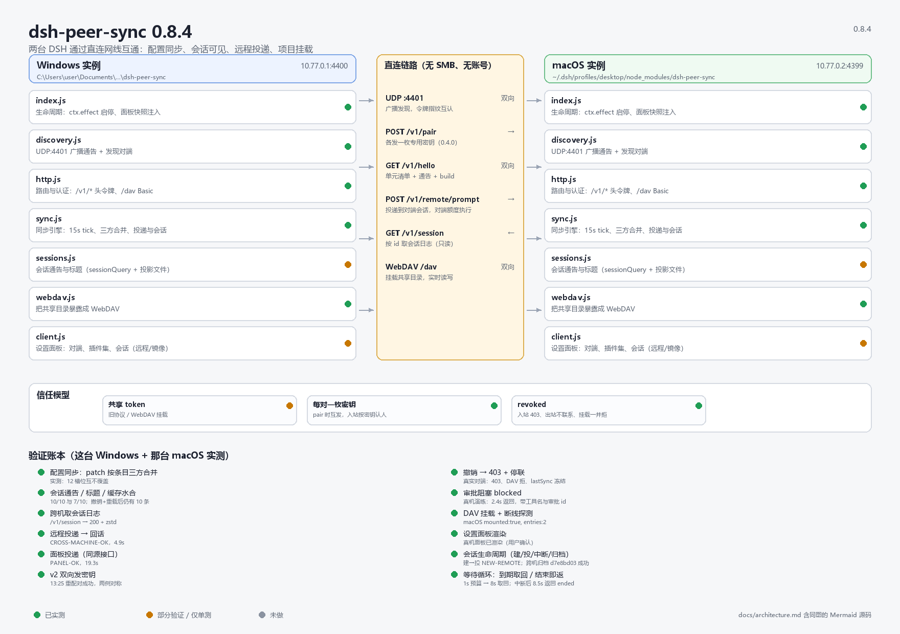
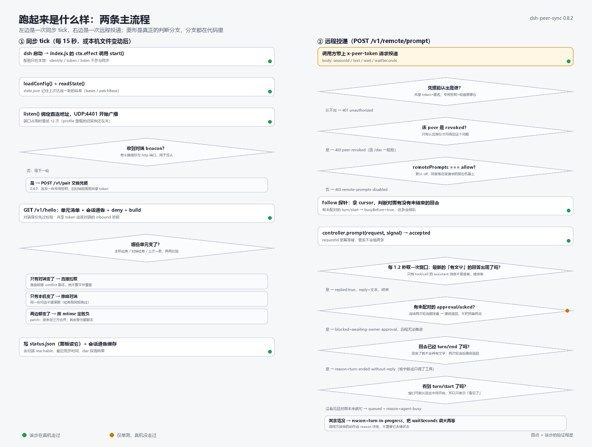
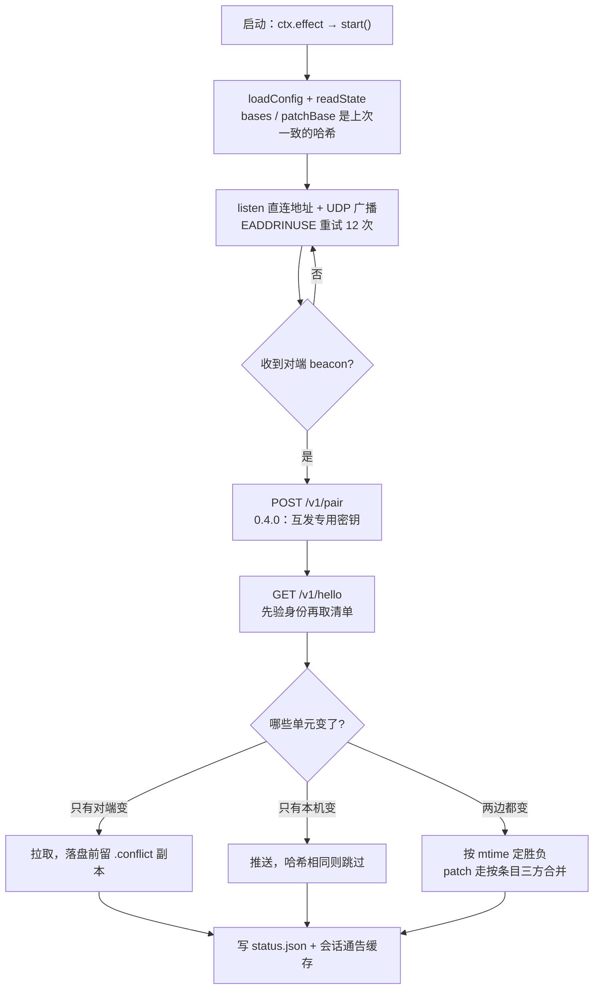
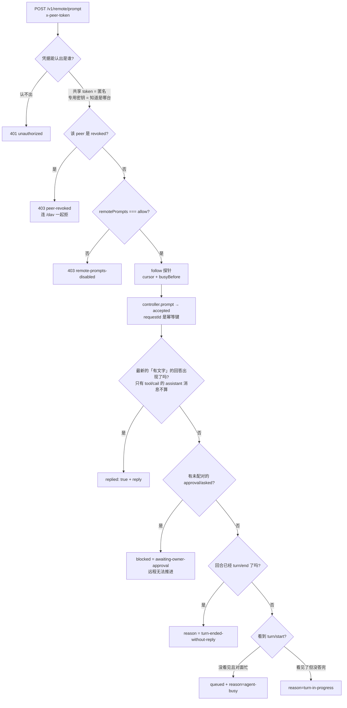

# 架构与现状

两张图都由仓库里的脚本生成，改代码后重新跑一次即可，不要手改 PNG：

```powershell
python docs\render-architecture.py   # -> docs/architecture.png
python docs\render-flow.py           # -> docs/flow.png
```

图里的文字（端口、路径、状态）是从代码里抄的，不是希望。





## 模块分工

| 文件 | 负责 | 关键导出 |
| --- | --- | --- |
| `index.js` | 生命周期、面板接口 `/api/peer-sync/*`（同源，loopback） | `apply` |
| `lib/sync.js` | 同步引擎：15 秒 tick、握手比较、三方合并、远程投递、建会话、状态文件 | `SyncEngine`、`mergeSessionList`、`openApproval`、`replyFromWindow`、`promptWindow`、`turnOpen`、`sessionsPublished`、`remoteSessionsAllowed` |
| `lib/http.js` | 对端通道：`/v1/*`（头令牌）+ `/dav`（Basic），两者共用同一套凭据判定 | `startServer` |
| `lib/config.js` | 本机配置：默认值、规范化、信任判定 | `loadConfig`、`saveConfig`、`trustOf`、`identifyPeer` |
| `lib/units.js` | 同步单元：patch / presets / credentials / 项目文件的收集与哈希 | `collectUnits`、`unitFromId`、`manifestOf` |
| `lib/patch.js` | `cordis.patch.yml` 的槽位化与按条目三方合并 | `mergePatch`、`patchContentHash`、`denyKeys` |
| `lib/apply.js` | 落盘：单元写入、冲突副本、插件集应用 | `applyUnit`、`applyBundleSet` |
| `lib/sessions.js` | 会话元数据与日志读取、标题（`sessionQuery` + 投影文件） | `listLocalSessions`、`sessionTitles`、`titleOf` |
| `lib/webdav.js` | WebDAV 服务端，够 macOS WebDAVFS 挂载用 | `createWebdav` |
| `lib/discovery.js` | UDP 广播与发现 | `startDiscovery` |
| `lib/atomic.js` | 原子写（临时文件 + rename） | `writeFileAtomic`、`writeBytesAtomic` |
| `lib/json.js` | 尽力而为的 JSON 读取（不因半截文件炸掉同步） | `readJson` |
| `lib/paths.js` | 所有路径解析（`~` 展开、profile 目录、状态目录） | `dshHome`、`patchPath`、`localDir` … |
| `lib/services.js` | 软服务查找：`ctx.get(name)`，没有 `inject` 也不抛 | `serviceOf` |
| `client.js` | 设置面板：对端、插件集、会话（远程/镜像）、挂载状态、发消息、建会话、撤销 | — |

## 两条通道，两套凭据

同源接口（GUI 服务器，loopback）与对端接口（直连监听器，头令牌）是**分开的**——把 token 放进页面等于给浏览器开后门，所以浏览器永远走左边这列：

| 接口 | 位置 | 认证 | 用途 |
| --- | --- | --- | --- |
| `GET /api/peer-sync/snapshot` | GUI 服务器 | loopback | 面板读快照（不再依赖注入） |
| `POST /api/peer-sync/prompt` | GUI 服务器 | loopback | 面板 → 对端会话投递 |
| `POST /api/peer-sync/result` | GUI 服务器 | loopback | 预算到期后取回答案（带 `peer` 走对端，不带走本机） |
| `POST /api/peer-sync/cancel` | GUI 服务器 | loopback | 中断回合（带 `peer` 走对端，不带走本机） |
| `POST /api/peer-sync/session/new` | GUI 服务器 | loopback | 本机新建会话 |
| `POST /api/peer-sync/session/remote` | GUI 服务器 | loopback | 面板 → 对端新建会话 |
| `POST /api/peer-sync/session/archive` | GUI 服务器 | loopback | 归档（带 `peer` 走对端，不带走本机） |
| `POST /api/peer-sync/session/unarchive` | GUI 服务器 | loopback | 取消归档（同上） |
| `POST /api/peer-sync/trust` | GUI 服务器 | loopback | 撤销 / 恢复对端 |
| `GET /api/peer-sync/introspect` | GUI 服务器 | loopback | 只读：查宿主服务的方法与元数（白名单） |
| `POST /v1/pair` | 对端监听器 | 配对策略 | 交换每对一枚密钥 |
| `GET /v1/hello` | 对端监听器 | 头令牌 / 专用密钥 | 单元清单 + 会话通告 + `build` |
| `POST /v1/remote/prompt` | 对端监听器 | 同上 + `remotePrompts: allow` | 投递并等待回话 |
| `GET /v1/remote/result` | 对端监听器 | 同上 + `remotePrompts: allow` | 只读：这个会话的回合产出到哪了 |
| `POST /v1/remote/cancel` | 对端监听器 | 同上 + `remotePrompts: allow` | 中断正在跑的回合 |
| `POST /v1/remote/session` | 对端监听器 | 同上 + `remotePrompts: allow` | 让对端建会话 |
| `POST /v1/remote/session/archive` | 对端监听器 | 同上 + `remotePrompts: allow` | 让对端归档会话 |
| `POST /v1/remote/session/unarchive` | 对端监听器 | 同上 + `remotePrompts: allow` | 让对端取消归档 |
| `GET /v1/session` | 对端监听器 | 同上 + 会话已通告 | 取会话日志（只读） |
| `/dav` | 对端监听器 | HTTP Basic（密码=凭据） | 挂载共享目录 |

同源那一列**没有额外令牌**：同机上任何进程都能调，和它能直接读 `config.json` 同级。这是取舍，不是遗漏。

## 组件图（同 architecture.png）

```mermaid
flowchart LR
  subgraph WIN["Windows 实例 · 10.77.0.1:4400"]
    W0["index.js 生命周期"]
    W1["discovery.js UDP:4401"]
    W2["http.js 路由 + 认证"]
    W3["sync.js 同步引擎"]
    W4["sessions.js 通告与标题"]
    W5["webdav.js /dav 服务端"]
    W6["client.js 设置面板"]
  end
  subgraph LINK["直连链路"]
    L1["UDP 广播 + 令牌指纹"]
    L2["POST /v1/pair<br/>各发一枚专用密钥"]
    L3["GET /v1/hello<br/>单元清单 + 通告 + build"]
    L4["POST /v1/remote/prompt<br/>对端额度执行"]
    L5["GET /v1/session<br/>只读取日志"]
    L6["WebDAV /dav<br/>挂载共享目录"]
  end
  subgraph MAC["macOS 实例 · 10.77.0.2:4399"]
    M0["index.js 生命周期"]
    M1["discovery.js UDP:4401"]
    M2["http.js 路由 + 认证"]
    M3["sync.js 同步引擎"]
    M4["sessions.js 通告与标题"]
    M5["webdav.js /dav 服务端"]
    M6["client.js 设置面板"]
  end
  W1 --- L1 --- M1
  W2 --- L2 --- M2
  W3 --- L3 --- M3
  W3 --- L4 --- M3
  W4 --- L5 --- M4
  W5 --- L6 --- M5
  W0 --> W3
  W6 -.读 status.json.-> W3
```

## 一次同步 tick（同 flow.png 左）



## 一次远程投递（同 flow.png 右）



## 验证账本

| 项 | 状态 | 证据 |
| --- | --- | --- |
| patch 按条目三方合并 | 已实测 | 两边 12 个槽位互不覆盖 |
| 会话通告与标题 | 已实测 | 10/10 与 7/10，跨机可读 |
| 跨机取会话日志 | 已实测 | `/v1/session` → 200 + `session.v4.jsonl.zstd` |
| 远程投递 → 回话 | 已实测 | `CROSS-MACHINE-OK`，4.9 秒 |
| 面板投递（同源接口） | 已实测 | `/api/peer-sync/prompt` → `PANEL-OK`，19.3 秒 |
| v2 双向发密钥 | 已实测 | 2026-10-27 13:25 重配对，两侧密钥对称 |
| 撤销 → 403 + 停联 | 已实测 | 真实对端：`403 peer-revoked`、`/dav` 同拒、`lastSyncAt` 冻结，恢复后立刻续传 |
| 审批阻塞 `blocked` | 已实测 | 真机演练：2.4 秒返回（两次轮询判定），带 `tool` 与审批 id，不耗满预算 |
| DAV 挂载 + 断线探测 | 已实测 | macOS `mounted:true, entries:2`；`ENOENT` 分支本机验过 |
| 设置面板渲染 | 已实测 | 真机面板已渲染可用；之前的空态是 `tapIndex` 注入不到页面，改成面板自己取 |
| 会话生命周期（建/投/中断/归档） | 已实测 | 面板建到对端 → 投入 `NEW-REMOTE-OK`；中断 → `turn/end`；归档本机通 |
| 在对端归档（跨机） | 已实测 | 我的面板归档她的 `d7e8bd03` → `archived:true` |
| 预算到期后取回答案 | 已实测 | 1 秒预算 → `turn-in-progress`；8 秒后 `/v1/remote/result` 拿到正文 |
| peek 最近结果（不投递） | 已实测 | 跨机直接读她的会话 → 200、`replied:true`、123 条记录、正文即她最后一条回话 |
| 结束即返回 | 已实测 | `sleep 45` 任务第 7 秒被中断，调用方 8.5 秒拿到 `turn-ended-without-reply` |
| 通告缓存的水合 | 已实测 | 撤销对端（不再有 hello）+ 重载 → 面板仍有 10 条，只能来自 `advert.json` |
| 建会话自动命名 | 已实测 | 她的入站回 `title: "来自 win 的会话"`，投影与通告都非空 |

## 三条设计取舍

1. **patch 按条目合并，不按文件。** 整文件 LWW 会在两台机器各改一个槽位时互相覆盖，而 `cordis.patch.yml` 恰好是两边都会改的文件。代价是合并后按 `id` 排序、`insert:` 块排在最后。
2. **不要 SMB。** WebDAV 复用已有的 HTTP 通道和那枚 token，不建系统账号、不开端口；代价是 macOS 的 WebDAVFS 只实现了它需要的那批方法，`LOCK` 不强制加锁。
3. **会话不搬、只投递。** 复制会话日志会产生两份真相；`share.sessions` 只通告、`sync.sessions` 才是复制（按需开启），投递让消息在拥有会话的那台机器上执行，消耗它的额度、按它的权限跑。
